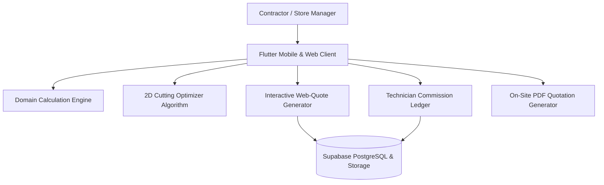

# DecorFlow — Smart Materials & 2D Cutting Optimization Platform

A specialized commercial platform designed for the **interior decoration, finishes, and cladding retail industry**. Solves critical sector-specific problems: minimizing sheet material waste, calculating complex dimensional finish requirements, managing technician referral commissions, and generating interactive web quotes.

---

## 🎯 The Real-World Industry Problem

In the interior decor sector (wood panel alternatives, marble acrylic sheets, cornices, molding profiles):
1. **Material Waste (15% - 25% Loss):** Contractors and technicians cut standard $122 \times 280\text{ cm}$ sheets arbitrarily on-site, producing massive scrap and costing clients extra sheets.
2. **Calculation Errors:** Estimating coverage in meters vs centimeters across diverse profiles (cornices, wall panels, adhesive tubes) creates frequent budget overruns.
3. **Lost Referral Commissions:** Contractors and technicians bring 80% of store sales but lack a transparent digital wallet to track earned commissions, harming customer retention.

---

## 🚀 Key Engineering Engines

### 1. 2D Panel Cutting Optimization Algorithm
* Calculates optimal 2D guillotine cut layouts for rectangular panels (marble alternative, MDF, wall panels) against raw sheet stock dimensions.
* Maximizes material surface utilization and mathematically isolates reusable offcut areas, systematically reducing client waste towards near-zero.
* Visualizes interactive cut schematics directly on-screen for site technicians.

### 2. Domain Material Calculation Engine
* Dynamic calculation models for:
  * **Sheet Stock:** Multi-sheet surface coverage derived from room/wall dimensions ($W \times H$).
  * **Linear Profiles:** Wood strip and cornice estimations per linear meter.
  * **Accessory Bundles:** Automatic ratio-based calculations for required adhesive silicone tubes and stainless joints.

### 3. Interactive Web-Quotes via WhatsApp
* Generates unique, encrypted web links allowing clients to interactively review quotes on their mobile browser.
* Clients can dynamically toggle accessories (e.g., LED backlights, adhesives) with real-time price re-evaluations.
* One-click "Confirm Order" triggers immediate store preparation notifications.

### 4. Technician & Contractor Digital Wallet
* Full double-entry ledger tracking commissions per technician for referred clients.
* Segregated pending vs available balances with withdrawal receipts.
* Automated branded PDF statement-of-account exports.

---

## 🏛️ System Architecture

---

## 🛠️ Tech Stack

* **Framework:** Flutter (Mobile & Web)
* **Language:** Dart
* **Backend:** Supabase (PostgreSQL, Auth, Storage)
* **Architecture:** Feature-First, Clean Architecture
* **State Management:** BLoC / Provider
* **Reporting:** PDF & Printing Engines for on-site client quotation exports
